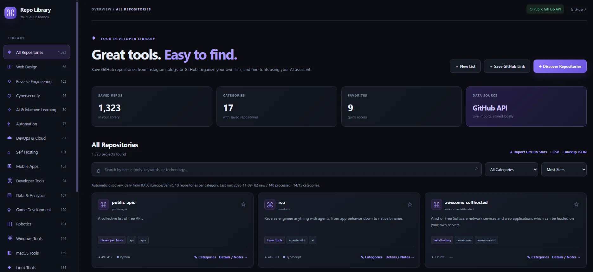

# GitHub Repo Library

A self-hosted, searchable catalog of useful GitHub repositories. Save links you find on social media, discover projects by topic, organize them into categories and personal lists, and let an AI assistant look up saved projects through a read-only REST API or optional local MCP server.

**Version 4.4 — English interface and backward-compatible category migration.**

## Screenshot




## Features

- **Repository discovery:** Import public repositories using GitHub's API, discover projects by category, or import GitHub stars.
- **Quick link import:** Paste `https://github.com/owner/repo` from Instagram, a blog, or anywhere else. The app reads the *GitHub URL*, not the original social media post.
- **15 built-in categories** plus **Other**: Web Design, Reverse Engineering, Cybersecurity, AI & Machine Learning, Automation, DevOps & Cloud, Self-Hosting, Mobile Apps, Developer Tools, Data & Analytics, Game Development, Robotics, Windows Tools, macOS Tools, and Linux Tools.
- **Multiple categories:** A repository can appear in more than one category, including several operating-system categories. Automatic classification uses GitHub topics and description heuristics; it does **not** verify platform compatibility.
- **Custom categories and personal lists:** Create your own categories, maintain multiple lists, add notes and favorites, and manually edit categories. Manual selections are preserved when importing again.
- **Search and navigation:** Search the local SQLite index, filter by category or list, sort results, and browse pages.
- **Daily discovery:** Search recent GitHub projects once per day, by default after 03:00 Europe/Berlin, up to 10 results per built-in category. The scan stores metadata, **not entire source-code repositories**. GitHub API rate limits still apply.
- **AI integration:** Read-only API-key-protected `/api/ai/*` endpoints and an optional local stdio MCP server. See [AI-INTEGRATION.md](AI-INTEGRATION.md).
- **Backup:** Export CSV or JSON; the persistent SQLite database lives inside `data/`.

## Requirements

- Docker Engine with Docker Compose, **or** Python 3.12+
- Internet access to `api.github.com` for imports and fresh repository content
- An optional GitHub token for higher API limits

## Docker installation

```bash
unzip GitHub-Repo-Library-v4.4-English-Docker.zip
cd github-repo-library
cp .env.example .env
# Edit .env and add an AI_API_KEY if you plan to use the AI REST API.
# Leave GITHUB_TOKEN empty for limited, unauthenticated public imports.
docker compose up -d --build
docker compose ps
```

The included Compose file deliberately binds port `8765` to `127.0.0.1`, so you can reach it locally at `http://127.0.0.1:8765`. To access it from another PC through SSH:

```bash
ssh -L 8765:127.0.0.1:8765 user@your-ubuntu-server
```

Then open `http://localhost:8765` on your PC. If you instead expose it on your LAN, protect access with a VPN or an authenticated reverse proxy. **Do not forward the unprotected web port from your router to the Internet.**

### Upgrade an existing v4.3 installation

**Keep your current `data/`, `.env`, and any customized `docker-compose.yml`.** This release renames the *built-in* German category labels stored in SQLite and updates the full-text index automatically at startup. Existing repositories, manually assigned categories, notes, favorites, and personal lists remain in place. User-created category names and personal-list content are not translated.

Copy the new ZIP next to your existing `github-repo-library` directory and run:

```bash
cd ~/Github/github-repo-library
# Stop the app first, so the SQLite backup is consistent.
docker compose stop
cp -a data "data.backup-$(date +%Y%m%d-%H%M%S)"
cd ~/Github
# Preserve your existing LAN port binding in docker-compose.yml.
unzip -o GitHub-Repo-Library-v4.4-English-Docker.zip \
  -x 'github-repo-library/docker-compose.yml'
cd github-repo-library
docker compose up -d --build
docker compose ps
```

Refresh the browser with **Ctrl+F5** to clear cached JavaScript. If you need to roll back to the older version, restore the pre-upgrade database backup first, because older releases do not understand the renamed built-in categories.

## Configuration

Edit `.env` (never commit it to GitHub):

```env
GITHUB_TOKEN=
AI_API_KEY=
AUTO_DISCOVER_ENABLED=true
AUTO_DISCOVER_HOUR=3
AUTO_DISCOVER_LIMIT=10
AUTO_DISCOVER_TZ=Europe/Berlin
```

Generate an AI API key:

```bash
python3 -c 'import secrets; print(secrets.token_urlsafe(36))'
```

Restart or recreate the container after changing environment variables:

```bash
docker compose up -d
```

To inspect logs, actual disk use, and resource consumption:

```bash
docker compose logs --tail=50
du -sh data
docker stats --no-stream github-repo-library
```

The default Compose volume `./data:/app/data` retains the database when the application container is rebuilt. **Do not delete `data/` during upgrades.**

## Running without Docker

```bash
cp .env.example .env
# The standard-library web application does not automatically load .env files.
# Export your configuration variables in your shell, or use Docker Compose.
python3 server.py
```

Without Docker, the application binds to `127.0.0.1:8765` by default.

## Classification and migration

Each repository has one primary category and potentially several additional tags. GitHub topics and explicit platform-support phrases in project descriptions influence automatic tagging. A generic `cross-platform` topic alone does not imply Windows, Linux, and macOS support. If you choose categories manually, later imports will not override them.

On the first start of v4.4, the following built-in category names are migrated:

| Previous stored label | English label |
| --- | --- |
| Webdesign | Web Design |
| KI & Machine Learning | AI & Machine Learning |
| Automatisierung | Automation |
| Daten & Analyse | Data & Analytics |
| Robotik | Robotics |
| Sonstiges | Other |

The remaining built-in labels were already English. Your own categories and personal-list names remain exactly as you entered them. The migration can safely run again and does not download any GitHub code.

## Security and limitations

- **No login on the web interface:** Only the `/api/ai/*` endpoints require `AI_API_KEY`. Other `/api/*` endpoints, including importing and editing repositories, do **not** require authentication. Keep this application inside a trusted network or place it behind authentication.
- Do not commit `.env`, `data/`, backups, secrets, or personal-list exports to a public GitHub repository.
- A saved GitHub repository is not a vetted or safe application. Inspect third-party code before running it.
- MCP lets a suitably configured agent import links and edit personal lists; the REST AI endpoints are read-only. Neither mechanism automatically installs or executes GitHub projects.
- The automatic scan only searches **built-in** categories. Custom categories are assigned manually.
- The library needs network access to GitHub only for imports and external file/README requests. Local searching works without a GitHub connection.

## Tests

```bash
python3 -m unittest discover -s tests -v
node --check web/app.js
```

Offline tests use mock GitHub responses and a temporary SQLite database. They are not substitutes for a full end-to-end test in your own browser and Docker environment.

## License and publishing

This project is licensed under the [MIT License](LICENSE), copyright © 2026 Musta95.

The included `.gitignore` excludes database files, backups, Python caches, and `.env`. Never commit private API tokens, local configuration, or personal SQLite databases.

See [AI-INTEGRATION.md](AI-INTEGRATION.md) for AI API and MCP setup.